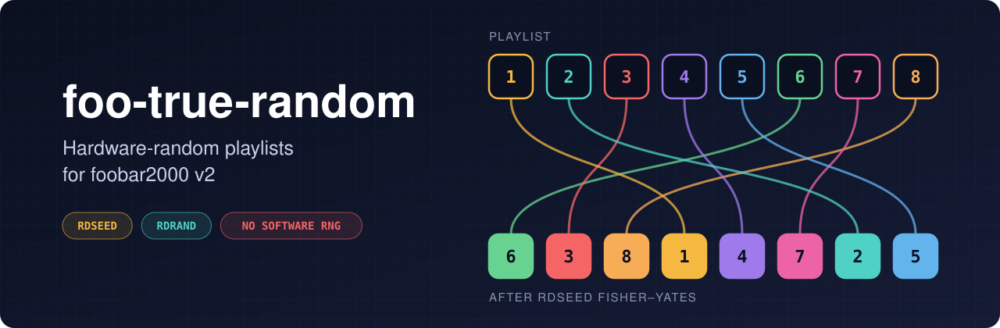
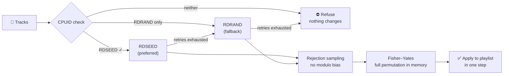

<p align="center">
  
</p>

<p align="center">
  <a href="https://github.com/Echolivity/foo-true-random/actions/workflows/build.yml"></a>
  <a href="https://github.com/Echolivity/foo-true-random/releases/latest"></a>
  
  
  <a href="LICENSE"></a>
</p>

<p align="center">
  <b>Shuffle your music with randomness straight from your CPU's hardware RNG,<br>
  using a mathematically unbiased algorithm. No software PRNG, no fallback.</b>
</p>

<p align="center">
  <a href="https://github.com/Echolivity/foo-true-random/releases/latest/download/foo-true-random.fb2k-component"><b>⬇ Download the latest .fb2k-component</b></a>
  &nbsp;·&nbsp; <a href="#-install">Install</a>
  &nbsp;·&nbsp; <a href="#-how-it-works">How it works</a>
  &nbsp;·&nbsp; <a href="#-faq">FAQ</a>
  &nbsp;·&nbsp; <a href="docs/DESIGN.md">Design docs</a>
</p>

---

## ✨ What it does

| | Command | Where | Result |
|---|---|---|---|
| 📚 | **True Random: Entire Media Library** | Edit menu | New playlist *True Random - Library* with every library track in hardware-random order |
| 🔀 | **True Random: Current Playlist** | Edit menu | Reorders the active playlist **in place** (no new playlist). **Ctrl+Z undoes it** |
| 🎯 | **True Random: Selected Tracks** | Right-click menu | New playlist *True Random - Selection* with just your selection, shuffled. Source playlist untouched |
| 🩺 | **True Random: Hardware RNG Status** | Edit menu | Shows what your CPU supports and which source is actually in use |

New playlists are activated after creation. Running a command again creates *True Random - Library (2)*, *(3)* and so on. Existing playlists are never reused or overwritten. Duplicate entries in a selection or playlist are kept, so a track that appears twice still appears twice.

Every action is logged to **View → Console**:

```text
foo_true_random: Current Playlist: Randomized 23 tracks in the current playlist using RDSEED (11 x 64-bit values).
```

> [!NOTE]
> It's a random playlist generator, nothing more. There are no recommendations, play-history weighting, "smart" ordering or settings.

## 🚀 Install

1. Download **[foo-true-random.fb2k-component](https://github.com/Echolivity/foo-true-random/releases/latest/download/foo-true-random.fb2k-component)**.
2. In foobar2000 go to **File → Preferences → Components → Install…**, pick the file, then click **Apply** and let foobar2000 restart.
   Double-clicking the file also works.
3. Check it works with **Edit → True Random: Hardware RNG Status**.

**Requirements:** foobar2000 **v2.x 64-bit** on Windows, and a CPU with `RDSEED` or `RDRAND`.

| CPU | RDSEED | RDRAND | Works? |
|---|:---:|:---:|---|
| Intel 5th gen (Broadwell) and newer | ✅ | ✅ | ✅ uses **RDSEED** |
| Intel 3rd–4th gen (Ivy Bridge, Haswell) | — | ✅ | ✅ uses **RDRAND** |
| Intel 2nd gen (Sandy Bridge) and older | — | — | ❌ refuses safely by design |
| AMD Ryzen (all generations) | ✅ | ✅ | ✅ uses **RDSEED** |

The component always checks the actual CPU at runtime. The table is a guide, not an assumption.

## 🔬 How it works



1. **Hardware only.** Random bits come from the CPU's `RDSEED` instruction, or `RDRAND` if RDSEED isn't available. There is no OS RNG, no `std::random_device` and no foobar2000 shuffle, not even as a hidden fallback.
2. **No modulo bias.** Each pick in `[0, n)` discards raw values below `2³² mod n` before reducing, so every outcome is exactly equally likely.
3. **Unbiased shuffle.** Fisher–Yates: `for i = n-1 … 1: swap(a[i], a[random(0..i)])`. Every order of your playlist is equally likely.
4. **Fail safe.** The whole new order is computed *before* foobar2000 is touched, so a hardware RNG failure changes nothing. If adding tracks to a new playlist fails, or an error occurs part-way, the incomplete playlist is removed and your previous active playlist is restored. This is a clean-up after failure, not an atomic transaction: other components may briefly see the new playlist. If the playlist list was changed by something else meanwhile, nothing is removed blindly; you're told to delete the leftover playlist yourself.

## 🛡 Guarantees, and how they're checked

| Guarantee | Evidence |
|---|---|
| Every possible order is equally likely | Exhaustive proofs in the test suite: every input value, every permutation counted, not sampled |
| Each track appears exactly once; duplicates are kept | Unit tests plus checks inside a real foobar2000 |
| Unsupported instructions are never executed | Mock CPU tests that fail if an unavailable instruction is ever called |
| Hardware failure never falls back to software | Tests for RDSEED exhaustion → RDRAND → refusal, and for "stuck" output |
| Failed operations leave no partial playlists | Failure-injection tests (refused, partial, and exception mid-insert), including against foobar2000's real playlist manager |
| Clean-up never deletes one of your playlists | Tests where another component changes the playlist list mid-operation: nothing is removed |
| Undo restores the exact previous order | Verified through foobar2000's own undo in CI |

Every push runs the whole suite in GitHub Actions: Linux with memory/UB sanitizers, Windows MSVC Debug and Release, and an **automated test inside foobar2000 v2.26.3** that installs the packaged component, checks all four commands are registered, and runs the three playlist commands (Status shows a popup and is checked manually). Details are in [docs/TESTING.md](docs/TESTING.md).

### Verified on

| Machine | OS | Result |
|---|---|---|
| Intel Core i7-13620H (user laptop) | Windows 11 25H2 | ✅ RDSEED in use, playlists shuffled |
| GitHub Actions Intel Xeon runners | Windows Server 2025 | ✅ full automated suite in foobar2000 |

## ❓ FAQ

<details>
<summary><b>The same song played twice before others played at all. Is the shuffle broken?</b></summary>

Most likely foobar2000's own **Playback → Order** is set to *Random* or *Shuffle*. That mode picks tracks with foobar2000's built-in shuffle and ignores the playlist order.
Set **Playback → Order → Default**, run *True Random: Current Playlist*, then start from the **first** track. Each track plays exactly once, in hardware-random order.
</details>

<details>
<summary><b>My PC says "hardware RNG unavailable". Can I enable a software fallback?</b></summary>

No, on purpose. Without RDSEED/RDRAND the component refuses rather than quietly using something else. This affects only quite old CPUs, such as Intel Sandy Bridge (2nd gen Core, 2011).
</details>

<details>
<summary><b>Is this "true" randomness?</b></summary>

RDSEED and RDRAND are CPU interfaces to an on-chip hardware random number generator. This project doesn't access raw physical noise and can't certify the quality of the CPU's entropy source; no software can. What it *does* guarantee, with proof, is that the hardware's random values are turned into playlist orders without any bias. More in [docs/HARDWARE_RNG.md](docs/HARDWARE_RNG.md).
</details>

<details>
<summary><b>Why does selecting one track say "no random values were needed"?</b></summary>

A single track has only one possible order. Select two or more tracks to shuffle.
</details>

<details>
<summary><b>Entire Media Library says the library isn't configured.</b></summary>

Add your music folders under **File → Preferences → Media Library**, wait for scanning to finish, then try again.
</details>

## 🛠 Building from source

You need Visual Studio 2022+ (Desktop C++, v143), CMake ≥ 3.20, and 7-Zip or Windows `tar`. In a **Developer PowerShell for VS**:

```powershell
git clone https://github.com/Echolivity/foo-true-random
cd foo-true-random
./scripts/fetch-sdk.ps1   # official foobar2000 SDK 2026-10-01, SHA-256 verified
./scripts/build.ps1       # Debug + Release x64 → dist\foo-true-random.fb2k-component
```

Run the tests (any OS with a C++20 compiler):

```sh
cmake -S . -B build-tests -DCMAKE_BUILD_TYPE=Release
cmake --build build-tests
ctest --test-dir build-tests --output-on-failure
```

<details>
<summary><b>Repository layout</b></summary>

```
include/ftr/                 portable core (no SDK): random_core.h · hardware_rng.h · playlist_logic.h
src/                         RNG source selection + the only code that runs CPUID / RDSEED / RDRAND
tests/                       exhaustive, mock-hardware, fake-playlist and real-CPU tests
foobar2000/foo_true_random/  the component itself + MSBuild project
scripts/                     fetch-sdk · build · package · integration-test
docs/                        DESIGN · HARDWARE_RNG · TESTING
```
</details>

## 📄 License

[MIT](LICENSE) © 2026 Echolivity. The foobar2000 SDK is downloaded at build time and not redistributed. foobar2000 is a product of its respective author; this is an independent third-party component.
